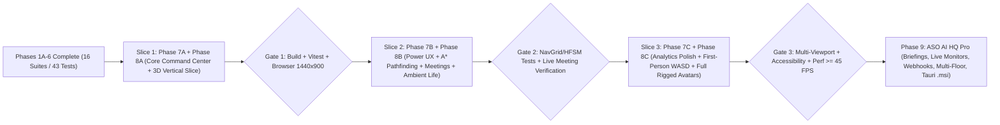

# خارطة تطوير ASO AI HQ (`Phases 7 – 9 Master Roadmap`)

> **الحالة الحالية:** اكتملت المراحل التأسيسية والتشغيلية الأساسية (`Phases 1A → 6`) بالكامل مع **16 ملف اختبار (43 اختباراً ناجحاً)** في `Vitest` وبناء إنتاجي مقسّم (`Code Splitting`) ومستودع حقائق موحّد في [company/](../../company/).
>
> تهدف المراحل **7 و8 و9** إلى تحويل المنصة إلى **مركز قيادة تنفيذي متكيف (`Adaptive Command Center`)** فوق **مكتب ثلاثي أبعاد حيّ وواقعي معمارياً (`Sunlit Architectural 3D Studio`)**، مربوط لحظياً دون أي تمثيل وهمي بمحرك الـ AI الفعلي.

---

## 1. المبادئ الهندسية المثبّتة (`/grill-me Locked Spec`)

1. **الصدق التشغيلي الصارم (`Truthful Runtime Source of Truth`):** الخادم (`JobSupervisor`, `MeetingEngine`, `OrchestratorDagEngine`, `ApprovalEngine`) هو المصدر الوحيد للحقيقة؛ المشهد 3D والواجهة يعكسان الأحداث الفعلية لحظياً دون تأخير التنفيذ بسبب أي أنيميشن.
2. **التطوير المتوازي المتدرّج (`3D-First Vertical Slices`):** نطوّر `Phase 7` (تجربة القيادة والواجهة) و`Phase 8` (المكتب ثلاثي الأبعاد) بالتوازي عبر 3 شرائح رأسية قابلة للاختبار والاعتماد بعد كل شريحة، ولا نبدأ `Phase 9` قبل استقرار 7 و8.
3. **الهوية الموحّدة:** بيئة **Sunlit Architectural Studio** (بلوط طبيعي + زجاج + إضاءة نهارية ناعمة) للمشهد 3D مع غلاف قيادة **Restrained Dark Glass Command Center** وتبديل كامل إلى `Sunlit Light` + إضاءة ديناميكية اختيارية `Day / Night`.
4. **مواءمة العتاد المثبت على الجهاز:** تم تصميم ميزانية الرسوميات لاستغلال **`NVIDIA RTX 3050 Laptop 4GB` + `AMD Ryzen 7 5800H`** مع دعم 3 مستويات جودة تكيفية (`High / Balanced / Eco`) وضمان **تكلفة `0 KB`** لحزمة Three.js عند البقاء في وضع `2D`.
5. **العربية والـ RTL أولاً مع التوافق العالمي:** دعم متساوٍ بالكامل للغتين العربية (`RTL`) والإنجليزية (`LTR`) وإمكانية الوصول عبر لوحة المفاتيح.

---

## 2. تدفق التنفيذ واعتماد الشرائح (`Delivery Cadence`)

---

## 3. فهرس ملفات التخطيط التفصيلية

| المرحلة | النطاق الأساسي | ملف الخطة الهندسية |
| :--- | :--- | :--- |
| **Phase 7** | نظام ثيم موحّد (`Dark Glass` + `Sunlit Light`)، `Ctrl+K` Command Palette، مركز الإشعارات، شريط الإعداد، ترقية `EmployeeDrawer`، موافقات Split-Pane، وتدوير + `Undo/Redo` في `2D` | [phase-7-ui-ux-command-center.md](phase-7-ui-ux-command-center.md) |
| **Phase 8** | مكتب `3D` معماري بالبلوط والزجاج (`R3F v9` + `React 19`)، واجهة `AvatarAdapter` هجينة (`Stylized` + `.glb`)، محرك `Dynamic A* NavGrid`، اجتماعات حية، `Ambient Life` قابل للضبط، ووضع `First-Person WASD` | [phase-8-living-3d-virtual-office.md](phase-8-living-3d-virtual-office.md) |
| **Phase 9** | الموجز اليومي الصباحي + TTS، شاشات Terminal حية في 3D، بوابة Webhooks موقعة (`HMAC`)، تعدد الطوابق وقوالب الشركات، وحزمة التثبيت الأصلية `Tauri v2 .msi` | [phase-9-pro-expansion.md](phase-9-pro-expansion.md) |

---

## 4. بوابة القبول المشتركة قبل الانتقال بين الشرائح

- `cmd /c "pnpm typecheck && pnpm test && pnpm build"` يخرج بكود **`0`** دون أخطاء أو تحذيرات حزمة الرئيسية.
- اختبارات Vitest لكل منطق سلوكي أو رياضي (`NavGrid A*`, `Behavior HFSM`, `Undo/Redo`, `Webhook HMAC`) تعمل بدون اشتراط WebGL.
- التحقق الحي عبر المتصفح على `http://127.0.0.1:5173` و`http://127.0.0.1:4310` بمقاسات `1440×900` و`1280×800` في `AR RTL` و`EN LTR` مع `0` أخطاء Console و`0` أخطاء HTTP `>= 400`.
