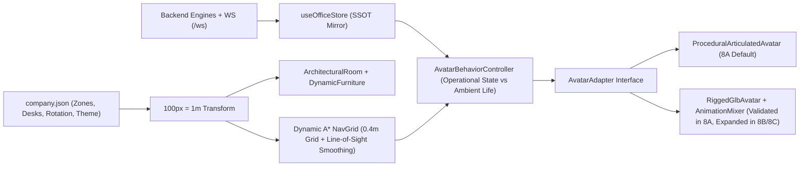

# Phase 8 — خطة المكتب ثلاثي الأبعاد الحيّ (`Living 3D Virtual Office — ASO AI HQ`)

> **الهدف:** بناء مكتب معماري ثلاثي الأبعاد حيّ (**`Sunlit Oak & Glass Studio`**) يتنفس بأحداث المحرك الفعلي (`JobSupervisor`, `OrchestratorDagEngine`, `MeetingEngine`, `ApprovalEngine`)، ويعمل بسلاسة `45–60 FPS` على جهازك (`AMD Ryzen 7 5800H` + `NVIDIA RTX 3050 4GB`) بدون أن يمس استقلالية أو سرعة الوضع الثنائي الأبعاد `2D`.

---

## 1. الأساس المعماري وحسم القرارات التقنية

### أ. التوافق مع Stack المشروع
- يعمل `apps/web` حالياً على **`react@^19.0.0`**؛ لذا يُشترط استخدام حزم React Three Fiber الداعمة لـ React 19 حصراً:
  - `three@^0.174` + `@types/three`
  - `@react-three/fiber@^9`
  - `@react-three/drei@^10`
- تحميل المشهد 3D كسولاً بالكامل (`React.lazy(() => import("./office3d/Studio3DCanvas.tsx"))`) داخل `WebGLErrorBoundary` بحيث يظل **وضع `2D` بـ `0 KB` من Three.js** إذا لم يُفعّل المستخدم الـ 3D، وإذا تعذّر WebGL يعود تلقائياً لـ 2D برسالة واضحة.

### ب. توضيح حاسم حول Pathfinding وSkills
1. **Dynamic A\* NavGrid بدلاً من `three-pathfinding` الثابت:**
   - بما أن `Phase 6` أضاف **محرر سحب وإفلات المكاتب** و`Phase 4 HR` يضيف مكاتب جديدة تلقائياً، فإن توليد شبكة المشي **`office-navgrid.ts`** بدقة `0.40m/cell` مباشرة من `company.json` (`width`, `height`, `zones`, `desks`, `rotationDeg`) يحدّث المسارات في **`0ms`** دون الحاجة لإعادة تصدير NavMesh من Blender.
2. **الـ Skills المستخدمة:**
   - الاعتماد على مهارتنا المثبتة [`animation-systems`](file:///C:/Users/ahmed%20essam/.gemini/config/skills/animation-systems/SKILL.md) (لبناء آلة الحالات الطبقية، `Crossfade blending`، وتجنب الانزلاق `foot sliding`).
   - إنشاء مرجع محلي مضبوط لقواعد **R3F v9 + Disposal + Instancing** في `docs/r3f-architecture.md` قبل كتابة أول مكوّن 3D.
   - لو تقرر استقدام أي Skill مجتمعية من GitHub لاحقاً لمرحلة Blender/GLB المتقدمة، تُفحص ملفاتها أمنياً قبل إضافتها.

---

## 2. المعمارية الحدثية وآلة الحالات (`Event-Driven Behavior System`)



### طبقتا السلوك وفصل الصدق التشغيلي
1. **طبقة الحالة التشغيلية الحقيقية (`Operational Truth` — من `selectEmployeeLiveState` و`meetings` و`taskPlans`):**
   - `WORKING` (`RUNNING` / `PLANNING`): العودة الفورية للمكتب ← الجلوس ← أنيميشن الكتابة + إضاءة الشاشة.
   - `WAITING_APPROVAL`: الوقوف/الجلوس مع **رفع اليد** وحلقة نبض كهرمانية فوق الشخصية + كارت اختصار للموافقة.
   - `MEETING` (`meeting.status === "RUNNING"` و`employeeId` ضمن المشاركين): السير عبر `NavGrid A*` إلى كرسي شاغر حول طاولة الاجتماعات البيضاوية، والالتفاف نحو المتحدث عند كل `turn` قادم عبر WebSocket.
   - `FAILED` / `BUDGET_EXCEEDED`: إشارة تنبيه حمراء هادئة فوق الشخصية مع إمكانية إعادة المحاولة من الدرج.
2. **طبقة الحياة المكتبية في وقت الفراغ الحقيقي (`Configurable Ambient Life`):**
   - تعمل **فقط** عندما يكون الموظف `IDLE` (لا يعمل، لا ينتظر موافقة، وليس في اجتماع)، ولا تستهلك أي توكنز أو APIs (`0 tokens`, `deterministic`).
   - **3 مستويات في الإعدادات:**
     - `Quiet`: يبقى الموظفون المتاحون في مكاتبهم مع تنفس وحركات طبيعية بسيطة.
     - `Balanced` *(الافتراضي)*: بعد `45–75s` من الفراغ الحقيقي، يقوم موظف واحد أو اثنان أحياناً للمشي نحو الـ Lounge أو ركن القهوة ثم يعودون.
     - `Lively`: حركة أكثر بين مناطق الاستراحة والجلوس على الأريكة.
   - **قاعدة المقاطعة الصارمة (`Instant Preemption`):** بمجرد وصول `run` أو `meeting` حقيقي للموظف، يبدأ التنفيذ على Backend فوراً بدون أي انتظار، وتلغي الشخصية نشاط الـ Ambient وتعود لمكتبها أو قاعة الاجتماعات بأقصى أولوية.
   - **خيار `Reduced Motion`:** يوقف المشي العشوائي والاهتزازات الزائدة لصالح وضوح ثابت.

---

## 3. بنية الملفات المقترحة (`apps/web/src/components/office3d/`)

```text
apps/web/src/components/office3d/
├── Studio3DCanvas.tsx          # Canvas, adaptive Quality tier, WebGL context loss handler
├── WebGLErrorBoundary.tsx      # Safe fallback back to 2D floorplan on WebGL error
├── OfficeScene.tsx             # Lighting rig (Day/Night/Dark Slate), themes, room sync
├── ArchitecturalRoom.tsx       # Oak floor, architectural walls, glass partitions, plants
├── DynamicFurniture.tsx        # Desks, monitors, chairs, oval meeting table, lounge sofa (instanced where possible)
├── CameraRig.tsx               # Isometric Orbit + Presets (Overview / Meeting / Employee Focus / Approval Focus)
├── FirstPersonController.tsx   # Optional WASD exploration + NavGrid collision clamp + E proximity prompt
├── navgrid.ts                  # Pure TS: company.json -> 2D walkability grid + A* + path smoothing
├── behavior-controller.ts      # Pure TS HFSM + Ambient Life scheduler + meeting seat assignment
├── DagHandoffArcs.tsx          # Animated 3D curved links between employees active in the same TaskPlan
└── adapters/
    ├── types.ts                # Unified AvatarAdapter props & animation clip contract
    ├── ProceduralAvatar.tsx    # Articulated stylized 3D employee avatar (Head/Torso/Arms/Legs + status halo)
    └── RiggedGlbAvatar.tsx     # useGLTF + SkeletonUtils.clone + AnimationMixer + Head Look-At + fallback
```

---

## 4. خارطة التنفيذ عبر الشرائح (`8A → 8B → 8C`)

### Phase 8A: الشريحة الرأسية الأولى (`3D Studio Vertical Slice`) *(تُبنى مع `Phase 7A`)*
1. **مشهد معماري دافئ مولّد من `company.json`:**
   - تحويل الإحداثيات (`100px = 1.0m`) لبناء أرضية البلوط، الجدران المحيطة، الفواصل الزجاجية شبه الشفافة لمكتب الإدارة وغرفة الاجتماعات، المكاتب بشاشاتها المضيئة، الطاولة البيضاوية بـ 6 كراسي، والأثاث.
   - مزامنة الثيم الثلاثي (`sunlit_studio`, `warm_sand`, `blueprint_slate`) + خيار إضاءة نهارية/ليلية (`Day / Night`).
2. **واجهة `AvatarAdapter` الهجينة + التحقق الفعلي للـ Rigged `.glb`:**
   - بناء `ProceduralArticulatedAvatar` بملامح هندسية نظيفة وألوان الأقسام + الأحرف التعريفية (`GM`, `HR`, `SE`, ...).
   - وضع نموذج GLB خفيف مرجعي مجاني (`CC0`) داخل `apps/web/public/assets/avatars/sample-rigged.glb` لاختبار **`RiggedGlbAvatar` (`AnimationMixer` + `SkeletonUtils.clone`)** مع موظف حقيقي واحد على الأقل داخل `8A` وإثبات نجاح مسار التحميل والـ Retargeting مبكراً (مع التبديل الفوري للوضع المفصلي عند غياب الملف).
3. **التفاعل الحقيقي وربط الأحداث:**
   - كاميرا **Isometric Orbit Management** افتراضية بمقيدات دوران ناعمة + أزرار Presets (`نظرة عامة`, `غرفة الاجتماعات`, `تركيز على رامي/كريم`, `آخر موافقة`).
   - النقر على أي شخصية يفتح **`EmployeeDrawer`** وتظل كل وظائف الشات والموافقات متزامنة لحظياً.
   - تشغيل سيناريو كامل End-to-End في `Mock` و`Live` لإثبات انتقال الشخصية تلقائياً بين `SeatedIdle → TypingActive → HandRaiseApproval → SeatedIdle`.

### Phase 8B: الحركة الذكية بالـ `A*` والاجتماعات الحية وخيوط الـ `DAG` *(تُبنى مع `Phase 7B`)*
1. **محرك `navgrid.ts`:**
   - حساب مناطق العوائق من `zones` (الجدران مع ترك فتحات أبواب تلقائية عند مداخل مكتب الإدارة وغرفة الاجتماعات!) ومن `desks` (مع احترام `rotationDeg`) + الطاولة البيضاوية والأريكة.
   - تنفيذ خوارزمية **A\*** + **Line-of-Sight String Pulling** لتتحرك الشخصيات بسلاسة بدون المشي كـ "روبوت متعرج" أو اختراق المكاتب.
   - إعادة بناء الشبكة فورياً عند حفظ أي تعديل في `2D Office Design Mode` أو عند تعيين موظف جديد من HR.
2. **اجتماعات الفريق الحية (`Live Meeting Choreography`):**
   - ربط `MeetingRecord` (من `useOfficeStore`): يمشي المشاركون إلى كراسي غرفة الاجتماعات الستة، يجلسون، يلتفتون نحو المتحدث صاحب آخر `turn` في الاجتماع، ثم يعودون لمكاتبهم عند `COMPLETED` / `CANCELLED`.
3. **نظام `Ambient Life` + أقواس الـ DAG:**
   - تفعيل المستويات الثلاثة (`Quiet | Balanced | Lively`) + `Reduced Motion` من شريط التحكم.
   - رسم أقواس تدفق البيانات ثلاثية الأبعاد (`DagHandoffArcs`) بين موظفي الخطة الواحدة النشطة.
   - شارات تلميح خفيفة عند الحوم فوق الشخصية (الاسم + الحالة التشغيلية الحالية باللغة النشطة).

### Phase 8C: وضع الاستكشاف الشخصي وتخصيص الشخصيات الكامل *(تُبنى مع `Phase 7C`)*
1. **وضع الاستكشاف الشخصي (`First-Person Exploration Mode`):**
   - مبدّل أوضاع واضح في الشريط: **`Orbit 3D` | `First-Person (WASD)` | `2D Blueprint` | `Design Mode`**.
   - حركة `WASD` + `Shift` للسرعة + منع عبور الجدران والأثاث عبر نفس `navgrid.ts`، وظهور تلميح تفاعلي عند الاقتراب من موظف أو غرفة (`اضغط E لفتح المحادثة` أو `اضغط E لبدء اجتماع`).
2. **تخصيص شخصيات `Rigged .glb` لكل موظف (`EmployeeProfileSchema`):**
   - إضافة حقول اختيارية آمنة لـ `EmployeeProfileSchema`:
     - `avatarModelUrl?: string` (مسار داخل `public/assets/` أو `company/assets/avatars/`)
     - `avatarTone?: string`
   - دعم Crossfade (`0.25s`) بين المقاطع (`Idle`, `Walk`, `Sit`, `Type`, `Talk`, `RaiseHand`) + `Head Look-At` نحو الشاشة أثناء العمل أو نحو الكاميرا/المتحدث عند الاقتراب في وضع First-Person، مع Fallback آمن 100% لـ `ProceduralAvatar` إذا خلا الحقل أو فشل التحميل.

---

## 5. ميزانية الأداء والتوافق مع `RTX 3050 4GB` + `iGPU`

| إعداد الجودة | `High (RTX Default)` | `Balanced` | `Eco (Battery / iGPU)` |
| :--- | :--- | :--- | :--- |
| **Pixel Ratio (`dpr`)** | `[1, 1.5]` | `[1, 1.25]` | `1` |
| **Shadows** | `PCFSoftShadowMap (1024px)` | `Basic (512px)` | `Off` |
| **Antialias / Post** | `MSAA WebGL` (بدون Bloom ثقيل) | `MSAA WebGL` | `Off` |
| **Target Draw Calls** | `< 80` (`InstancedMesh` للأثاث) | `< 65` | `< 50` |
| **Tab Hidden Behavior** | `frameloop="demand"` (تجميد `0% GPU`) | تجميد `0% GPU` | تجميد `0% GPU` |

- **منع تسرب الذاكرة (`GPU Memory Hygiene`):** تنظيف `geometry`, `material`, و`texture` عند تفريغ أي مشهد أو تغيير موظفين (`useEffect` cleanup).

---

## 6. اختبارات القبول لـ Phase 8

1. **اختبارات وحدة (`Vitest` في بيئة Node بدون WebGL):**
   - `navgrid.test.ts`: اختبار أن المسار يتجنب المكاتب والجدران، يعبر الأبواب تلقائياً، يحدّث المسار عند تدوير/تحريك مكتب في `company.json`، ولا يعيد نقاطاً داخل العوائق.
   - `behavior-controller.test.ts`: اختبار انتقالات `HFSM` الكاملة، وحتمية مقاطعة `AmbientRoam` فوراً عند وصول `Run` أو `Meeting` حقيقي، واحترام وضع `Quiet` و`Reduced Motion`.
2. **اختبار المتصفح والأداء:**
   - تبديل مستمر `2D Blueprint ⇄ 3D Orbit ⇄ First-Person WASD ⇄ Design Mode` على `1440×900` بدون تسرب WebGL context أو أخطاء Console.
   - التحقق من تحرك موظف إلى غرفة الاجتماعات أثناء اجتماع `Mock` حقيقي وعودته، ورفع يد موظف أثناء `WAITING_APPROVAL` ثم عودته للكتابة بعد التوقيع.
